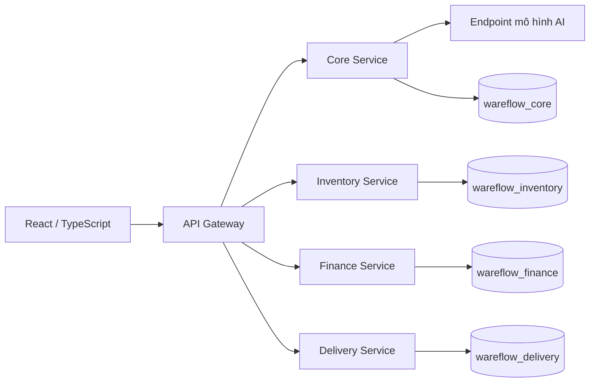

# Tổng quan dự án WareFlow

WareFlow là hệ thống quản lý kho và vận hành logistics dành cho nhiều công ty. Hệ thống hỗ trợ quản lý kho, mua hàng từ nhà cung cấp, theo dõi tồn theo sản phẩm và lô, xử lý chứng từ nhập xuất, quản lý vận đơn và theo dõi dòng tiền. Ba vai trò trên giao diện là **Admin WareFlow**, **Quản trị công ty** và **Quản lý kho**. TLTN AI hỗ trợ tra cứu và thực hiện một số thao tác trong phạm vi của người dùng đang đăng nhập.

## 1. Chức năng theo vai trò

| Vai trò | Phạm vi và chức năng |
| --- | --- |
| **Admin WareFlow** | Xem dashboard toàn hệ thống, quản lý và duyệt công ty, tạo và cập nhật kho hệ thống, xử lý đề nghị mua, thuê hoặc trả kho. Quản lý nhà cung cấp và sản phẩm cung ứng. Nạp tiền vào ví công ty hoặc ví kho, xem vận đơn, thông báo, nhật ký, báo cáo tài chính và xuất CSV thu chi. |
| **Quản trị công ty** | Tạo lô mua từ danh mục nhà cung cấp, chọn nhiều lô và thanh toán để nhập kho. Duyệt yêu cầu nhập từ kho, xem tồn theo kho, lập phiếu điều chuyển hoặc hoàn hàng cho nhà cung cấp. Đề nghị mua hoặc thuê kho và phân công quản lý khi bàn giao. Thêm, sửa, khóa hoặc xóa nhân viên. Lập ngân sách, chuyển tiền từ ví công ty sang ví kho, ghi thu chi và xử lý đề nghị chi. |
| **Quản lý kho** | Quản lý sản phẩm và lô trong kho được giao, xem tồn khả dụng và cảnh báo tồn thấp hoặc hạn dùng, đánh dấu hàng hỏng và xuất CSV tồn kho. Tạo lô mua và gửi yêu cầu nhập. Tạo phiếu xuất nháp theo SKU, chỉnh tỷ lệ giá bán, gửi duyệt và hoàn tất xuất sau khi được duyệt. Theo dõi vận đơn, cập nhật trạng thái giao và xác nhận COD. Xem lịch sử nhập xuất, số dư, ngân sách và gửi đề nghị chi. |

### Các luồng nghiệp vụ chính

1. **Cấp kho cho công ty.** Quản trị công ty gửi đề nghị mua hoặc thuê kho. Admin WareFlow xử lý đề nghị. Khi bàn giao, công ty phân công người quản lý kho.
2. **Mua và nhập hàng.** Quản trị công ty chọn sản phẩm từ danh mục, tạo lô mua và có thể thanh toán nhiều lô cùng lúc. Với luồng do kho khởi tạo, quản lý kho lập lô mua và gửi yêu cầu để công ty duyệt. Sau khi hoàn tất nhập, người dùng xem lại tồn kho và lịch sử nhập xuất.
3. **Xuất kho và giao hàng.** Quản lý kho tạo phiếu nháp, thêm sản phẩm theo SKU, chỉnh tỷ lệ giá bán và gửi duyệt. Khi phiếu được duyệt, quản lý kho hoàn tất xuất, cập nhật vận đơn và xác nhận thu hộ (COD) khi áp dụng.
4. **Điều chuyển và hoàn hàng.** Quản trị công ty lập phiếu điều chuyển hoặc hoàn hàng cho nhà cung cấp. Người dùng theo dõi chứng từ và đối chiếu tồn theo kho sau khi hoàn tất nghiệp vụ.
5. **Vận hành ví và ngân sách.** Admin nạp tiền, quản trị công ty phân bổ tiền sang ví kho và xử lý đề nghị chi từ kho. Các màn hình tài chính hỗ trợ theo dõi số dư, giao dịch và báo cáo theo phạm vi quyền.

### TLTN AI

Trợ lý trả lời câu hỏi sử dụng, tra sản phẩm hoặc lô theo phạm vi quyền, mở màn hình và điền sẵn dữ liệu cho một số form. Với câu **“Tạo đơn mua 3 SK1-01”**, người dùng kiểm tra lại SKU và số lượng trước khi xác nhận tạo đơn. Một số thao tác dùng mã chứng từ gồm duyệt hoặc hủy yêu cầu nhập, gửi duyệt phiếu xuất và cập nhật vận đơn. Các nghiệp vụ chưa có lệnh trực tiếp được xử lý trên giao diện.

## 2. Kiến trúc và các thành phần

Frontend gọi REST API qua Gateway. Eureka hỗ trợ đăng ký và tìm dịch vụ, còn Config Server cung cấp cấu hình tập trung. Bốn dịch vụ nghiệp vụ dùng bốn cơ sở dữ liệu logic trên PostgreSQL. Luồng nhập, xuất, thanh toán và giao hàng có thể đi qua nhiều dịch vụ tùy chứng từ và bước xử lý.

| Thành phần | Cổng mặc định | Trách nhiệm |
| --- | ---: | --- |
| `api-gateway` | 8080 | Điểm vào API, định tuyến các nhóm `/api/core`, `/api/inventory`, `/api/finance` và `/api/delivery`. |
| `eureka-server` | 8761 | Đăng ký và khám phá dịch vụ. |
| `config-server` | 8888 | Cấp cấu hình qua `backend/config-repo/`. |
| `core-service` | 8081 | Xác thực, tài khoản, công ty, kho, nhà cung cấp, danh mục cung ứng, thông báo, nhật ký và trợ lý. |
| `inventory-service` | 8082 | Sản phẩm tồn kho, lô, lô mua, yêu cầu nhập, phiếu xuất, điều chuyển và biến động tồn. |
| `finance-service` | 8083 | Ví, giao dịch thu chi, ngân sách, đề nghị chi, thanh toán chứng từ và báo cáo tài chính. |
| `delivery-service` | 8084 | Vận đơn, đối tác vận chuyển, trạng thái giao hàng và COD. |

### Cấu trúc frontend

- `frontend/src/routers/` khai báo tuyến giao diện. `frontend/src/page/` tổ chức màn hình theo nhóm vai trò, còn `frontend/src/components/workspace/` chứa các thành phần dùng chung, biểu mẫu và giao diện trợ lý.
- `frontend/src/services/` chứa lớp gọi API và logic lấy dữ liệu phục vụ các màn hình. `frontend/src/store/` quản lý trạng thái bằng Redux Toolkit.
- [`workspaceSlice.ts`](frontend/src/store/slice/workspaceSlice.ts) giữ kho được chọn theo phạm vi phiên và dữ liệu nháp theo khóa biểu mẫu. `OperationForm.tsx` dùng slice này để cập nhật và dọn bản nháp. `querySlice.ts` giữ trạng thái truy vấn API. Dữ liệu nháp trong Redux phục vụ thao tác trên giao diện, còn chứng từ nghiệp vụ được tạo qua API.

## 3. Công nghệ sử dụng

| Hạng mục | Công nghệ và cách dùng |
| --- | --- |
| Giao diện | **React 19, TypeScript 5.9, Vite 8** để phát triển và build frontend. **React Router** điều hướng giữa các màn hình. |
| Thành phần giao diện | **Ant Design**, **Tailwind CSS 4** và CSS của dự án cho giao diện. **Lucide React** cho biểu tượng, **Recharts** cho biểu đồ và **Day.js** cho ngày giờ. |
| Trạng thái, form và HTTP | **Redux Toolkit, React Redux** cho trạng thái dùng chung. **React Hook Form, Zod** cho biểu mẫu và kiểm tra dữ liệu. **Axios** cho HTTP. |
| Backend | **Java 21, Spring Boot 4.1.2, Gradle Wrapper** theo các tệp build trong repo. **Spring Cloud Gateway, Netflix Eureka và Spring Cloud Config** cho hạ tầng microservices. |
| Dữ liệu, xác thực và ảnh | **PostgreSQL 16, Spring Data JPA, Hibernate** cho lưu trữ nghiệp vụ. **Spring Security, JWT/JJWT** cho xác thực và phân quyền. **Cloudinary** hỗ trợ lưu ảnh. |
| AI | Core Service tích hợp endpoint mô hình theo cấu hình. Compose bổ sung hỗ trợ chạy **Ollama** cục bộ và có ví dụ tải mô hình **Qwen 2.5 3B**. |
| Vận hành và kiểm thử | **Docker và Docker Compose** cho backend và PostgreSQL. Repo có kiểm thử Java với **JUnit/Spring Boot Test**, script **Node.js** kiểm tra API và kịch bản giao diện chạy **Chrome headless**. |

## 4. Thành viên và phần phụ trách

Phân công chính dựa trên thông tin của nhóm. Các đầu việc minh họa được đối chiếu với mã nguồn, tên commit và tệp kiểm thử trong repo. Những hạng mục tích hợp có thể có đóng góp của nhiều thành viên.

| Thành viên | Phụ trách chính | Đầu việc và phần có thể trình bày khi bảo vệ |
| --- | --- | --- |
| **Tân** | **Trưởng nhóm, backend, frontend và các việc chung** | Điều phối tích hợp giữa các phần của nhóm. Tham gia hoàn thiện luồng backend và kết nối giao diện với API. Lịch sử repo ghi nhận các đầu việc quản lý lô mua, nhập lô, hiển thị giao dịch và biểu đồ dòng tiền. Ở frontend có các chỉnh sửa về phân trang, chuyển tab và bố cục các vai trò. Ở phần vận hành có cập nhật script deploy và `deploy.bat`. Khi bảo vệ, Tân có thể mở đầu, giới thiệu kiến trúc, vai trò Admin và cách ghép các phần thành quy trình hoàn chỉnh. |
| **Linh** | **Frontend chính** | Phát triển và tích hợp các workspace theo vai trò, xử lý dữ liệu API trên màn hình, cập nhật phần tính toán thống kê từ dữ liệu thật và loại bỏ dữ liệu demo không còn dùng. Lịch sử repo cũng ghi nhận đóng góp về bố cục landing, footer và chẩn đoán lỗi kiểm thử trình duyệt. Khi bảo vệ, Linh có thể thao tác luồng công ty tạo lô, duyệt nhập và luồng kho tra tồn, tạo phiếu xuất. Các thư mục màn hình, component dùng chung và Redux là chỗ minh họa cách frontend tổ chức luồng thao tác. |
| **Nguyên** | **Backend chính** | Xây dựng và mở rộng API kho, tài chính và vận đơn. Các phần đóng góp thể hiện trong lịch sử gồm nhập hàng và ghi biến động tồn, xuất kho, điều chuyển, lô mua, yêu cầu nhập, ví và thanh toán chứng từ, vận đơn, COD và thống kê thu chi. Nguyên cũng tham gia các API tài khoản, bàn giao kho và tích hợp trợ lý hội thoại. Khi bảo vệ, Nguyên có thể giải thích dữ liệu và trạng thái đi qua Core, Inventory, Finance và Delivery như thế nào, sau đó minh họa một lệnh trợ lý có xác nhận. |
| **Trang** | **Kiểm thử chính, có tham gia frontend** | Kiểm thử các luồng xác thực và quản lý công ty, mua hoặc thuê kho, nhập hàng, xuất hàng, điều chuyển và tài chính. Đối chiếu kết quả theo vai trò, mã chứng từ, trạng thái và dữ liệu hiển thị. Lịch sử repo còn ghi nhận đóng góp frontend ở trang quản lý hàng hóa, trang nhập hàng và nhận hàng. Khi bảo vệ, Trang có thể trình bày dữ liệu chuẩn bị, kết quả mong đợi và cách kiểm tra lại sau mỗi thao tác. |

## 5. Kiểm thử và chuẩn bị demo

| Kịch bản | Kết quả cần đối chiếu |
| --- | --- |
| Đăng nhập từng vai trò và mở workspace | Đúng menu, thao tác và phạm vi công ty hoặc kho của tài khoản. |
| Tạo lô mua và gửi yêu cầu nhập | Đúng nhà cung cấp, SKU, số lượng, kho đích và mã yêu cầu. |
| Duyệt yêu cầu nhập và hoàn tất nhập | Đúng trạng thái chứng từ, số lượng tồn và lịch sử nhập xuất. |
| Tạo phiếu xuất, gửi duyệt và hoàn tất xuất | Đúng SKU, số lượng, tỷ lệ giá bán và biến động tồn sau khi hoàn tất. |
| Cập nhật vận đơn có COD | Đúng mã vận đơn, trạng thái giao và kết quả xác nhận thu hộ. |
| Chuyển tiền sang ví kho hoặc xử lý đề nghị chi | Đúng ví, số tiền, trạng thái và giao dịch hiển thị. |
| Dùng TLTN AI tạo đơn mua 3 `SK1-01` | Thông tin đúng trước khi xác nhận và đơn xuất hiện sau khi xác nhận. |

Repo có bộ kiểm thử cho xác thực và quyền công ty, trợ lý, phiếu xuất, báo cáo tài chính và vận đơn. Kịch bản API nhập hàng nằm tại [`backend/tests/batch-import.e2e.mjs`](backend/tests/batch-import.e2e.mjs). Các kịch bản web nằm trong [`frontend/tests/`](frontend/tests/), gồm kiểm thử tích hợp, giao diện, kho, hồ sơ và lô tồn. Bảng trên là kỳ vọng dùng khi demo hoặc kiểm thử, chưa ghi nhận kết quả của một lần chạy.

## 6. Vị trí cấu hình và hướng dẫn chạy

- [`README.md`](README.md) hướng dẫn chạy Core Service và backend bằng Gradle hoặc Docker.
- [`docker-compose.yml`](docker-compose.yml) cấu hình PostgreSQL, Gateway, Eureka, Config Server và bốn dịch vụ nghiệp vụ. [`docker-compose.ai-local.yml`](docker-compose.ai-local.yml) bổ sung Ollama cho môi trường AI cục bộ.
- [`frontend/package.json`](frontend/package.json) khai báo các lệnh `npm run dev`, `npm run build`, `npm run lint`, `npm test` và `npm run test:ui` trong thư mục `frontend`.
- [`backend/BACKEND_CONTEXT.md`](backend/BACKEND_CONTEXT.md) mô tả hệ thống backend và cấu trúc API chi tiết hơn. Các phiên bản trong tài liệu tổng quan này được lấy từ tệp build, manifest và Compose của repo.
