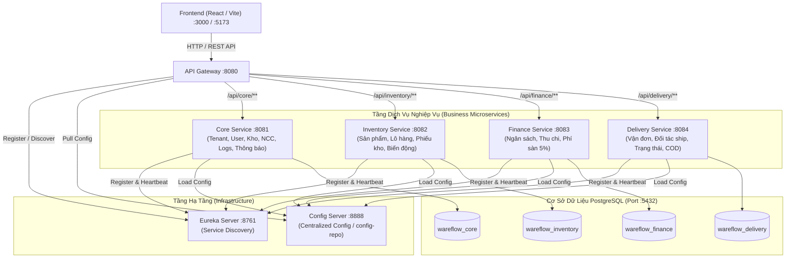
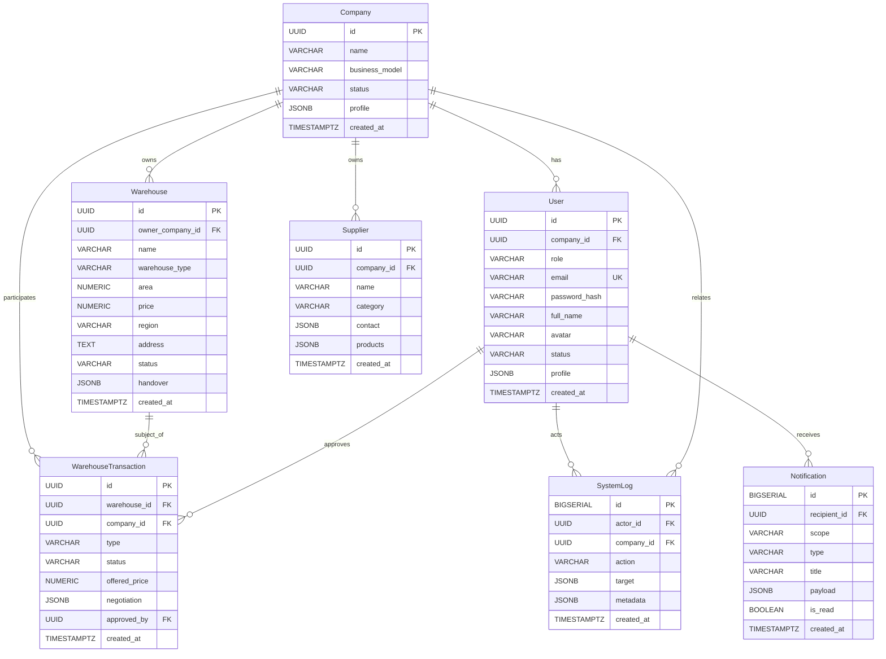
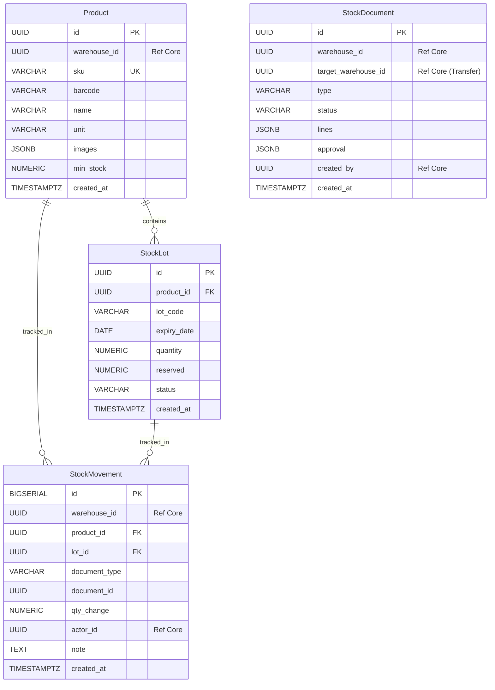
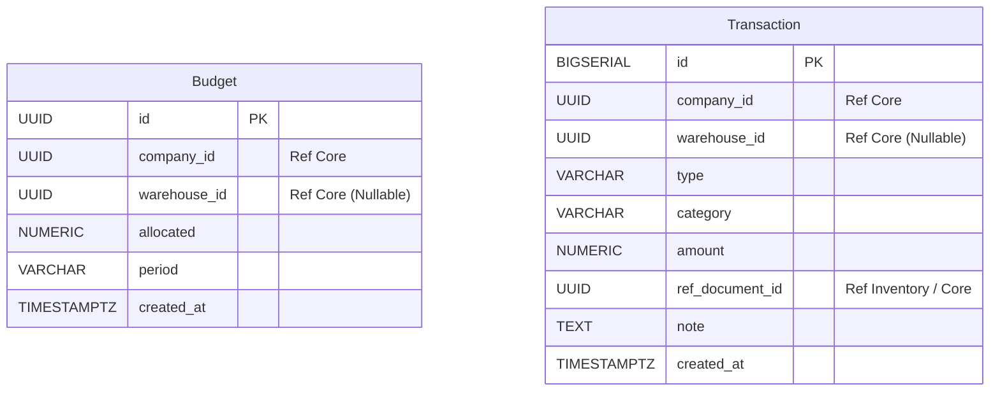
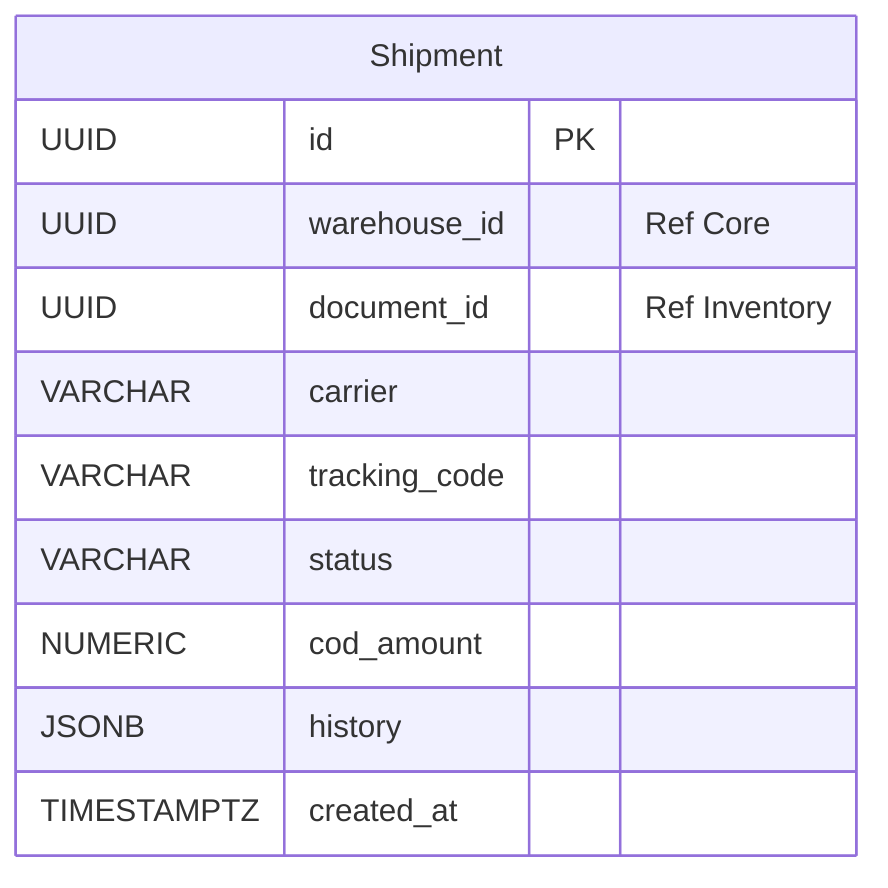

# WareFlow Backend - Comprehensive Architecture & AI Context Specification

> **Tài liệu chuẩn hóa toàn bộ Backend WareFlow dành cho AI Agents và Developers.**
> Đọc tài liệu này để hiểu toàn bộ kiến trúc, mô hình dữ liệu (Entity/Database), luồng nghiệp vụ liên dịch vụ, cấu hình mạng, cổng (Port), định tuyến (Routing) và quy chuẩn phát triển.

---

## 1. Tổng quan Kiến trúc Hệ thống (System Architecture)

WareFlow là nền tảng quản trị chuỗi cung ứng, kho bãi đa chi nhánh/công ty con (Multi-tenant B2B).
Backend được thiết kế theo kiến trúc **Spring Cloud Microservices**, phân tách độc lập giữa các tầng hạ tầng (Discovery, Config, Gateway) và các dịch vụ nghiệp vụ (Core, Inventory, Finance, Delivery).

### Sơ đồ kiến trúc tổng thể (Architecture Topology)



---

## 2. Technology Stack & Multi-Module Structure

* **Ngôn ngữ**: Java 21 (LTS).
* **Framework**: Spring Boot 4.x / 3.4.x, Spring Cloud `2025.1.3`.
* **Database**: PostgreSQL 16 (Hỗ trợ native JSONB, UUID, BIGSERIAL, TIMESTAMPTZ).
* **ORM & Persistence**: Spring Data JPA, Hibernate 6 (`@JdbcTypeCode(SqlTypes.JSON)`).
* **Công cụ Build**: Gradle 9.x Multi-Module (`settings.gradle` bao hàm 7 projects).
* **Containerization**: Docker, Docker Compose, Alpine JRE 21.

### Cấu trúc thư mục Gradle
```
backend/
├── build.gradle                 # Root Gradle (apply false cho plugins)
├── settings.gradle              # Quản lý 7 modules con
├── config-repo/                 # Thư mục chứa file cấu hình cho Config Server
│   ├── core-service.yml
│   ├── inventory-service.yml
│   ├── finance-service.yml
│   └── delivery-service.yml
├── eureka-server/               # Service Discovery (Port 8761)
├── config-server/               # Centralized Config Server (Port 8888)
├── api-gateway/                 # Spring Cloud Gateway Webflux (Port 8080)
├── core-service/                # Business Service 1 (Port 8081)
├── inventory-service/           # Business Service 2 (Port 8082)
├── finance-service/             # Business Service 3 (Port 8083)
├── delivery-service/            # Business Service 4 (Port 8084)
└── docker/
    └── postgres-init/
        └── init-databases.sql   # Khởi tạo 4 DB: wareflow_core, wareflow_inventory, ...
```

---

## 3. Mạng, Cổng Dịch Vụ và Định Tuyến Gateway (Networking & Routing)

### Bảng phân bổ Port & Database

| Tên Dịch Vụ | Module Directory | Port | Database Name | Prefix Endpoint qua Gateway |
| :--- | :--- | :---: | :--- | :--- |
| **API Gateway** | `api-gateway` | `8080` | *Không có* | `http://localhost:8080/*` |
| **Eureka Server** | `eureka-server` | `8761` | *Không có* | Giao diện Dashboard: `http://localhost:8761` |
| **Config Server** | `config-server` | `8888` | *Không có* | API cấu hình: `http://localhost:8888/{service}/{profile}` |
| **Core Service** | `core-service` | `8081` | `wareflow_core` | `http://localhost:8080/api/core/**` |
| **Inventory Service**| `inventory-service` | `8082` | `wareflow_inventory`| `http://localhost:8080/api/inventory/**` |
| **Finance Service** | `finance-service` | `8083` | `wareflow_finance` | `http://localhost:8080/api/finance/**` |
| **Delivery Service** | `delivery-service` | `8084` | `wareflow_delivery` | `http://localhost:8080/api/delivery/**` |

### Quy tắc Routing tại Gateway (`StripPrefix=2`)
Khi client gọi request đến Gateway:
* `GET http://localhost:8080/api/core/users` 
  $\rightarrow$ Gateway bỏ `/api/core`, chuyển tiếp đến `core-service:8081/users`.
* `POST http://localhost:8080/api/inventory/products`
  $\rightarrow$ Gateway bỏ `/api/inventory`, chuyển tiếp đến `inventory-service:8082/products`.
* `GET http://localhost:8080/api/finance/transactions`
  $\rightarrow$ Gateway bỏ `/api/finance`, chuyển tiếp đến `finance-service:8083/transactions`.
* `POST http://localhost:8080/api/delivery/shipments`
  $\rightarrow$ Gateway bỏ `/api/delivery`, chuyển tiếp đến `delivery-service:8084/shipments`.

### CORS Configuration
Gateway mở sẵn CORS cho:
* Origins: `http://localhost:3000`, `http://localhost:5173`, `http://127.0.0.1:3000`, `http://127.0.0.1:5173`.
* Methods: `GET`, `POST`, `PUT`, `DELETE`, `PATCH`, `OPTIONS`.
* Headers: `*`, `allowCredentials: true`.

---

## 4. Đặc tả Chi tiết Entity & Cơ sở dữ liệu (Domain Models)

### Nguyên tắc thiết kế (Design Principles):
1. **Database-per-service**: Mỗi service sở hữu cơ sở dữ liệu riêng, không join bảng trực tiếp qua SQL giữa 2 database khác nhau.
2. **Khóa ngoại xuyên service (Cross-service reference)**: Tham chiếu bằng `UUID` (ví dụ: `warehouseId`, `companyId`, `documentId`), không dùng Hibernate `@ManyToOne` xuyên database.
3. **Quan hệ nội bộ (Intra-service)**: Dùng chuẩn JPA `@ManyToOne(fetch = FetchType.LAZY)`.
4. **Kiểu dữ liệu JSONB**: Các trường thuộc tính động (profile, snapshot handover, lines chi tiết phiếu, payload thông báo, lịch sử vận chuyển) được lưu dạng `JSONB` trong PostgreSQL và map vào Java qua `@JdbcTypeCode(SqlTypes.JSON)`.
5. **Thời gian**: Lưu kiểu `Instant` (`TIMESTAMPTZ` trong PostgreSQL) kèm `@CreationTimestamp`.
6. **Tiền tệ & Số lượng**: Dùng `BigDecimal` (`NUMERIC` trong DB) để tránh sai số dấu phẩy động.

---

### 4.1. Core Service (`core-service`) - Database: `wareflow_core`

Chịu trách nhiệm quản lý tổ chức (Company), tài khoản (User), danh mục kho bãi (Warehouse), giao dịch mua bán thuê kho (WarehouseTransaction), nhà cung cấp (Supplier), nhật ký (SystemLog) và thông báo (Notification).



#### Chi tiết các Entity:

1. **`Company` (`companies`)**
   * `id`: `UUID` (PK).
   * `name`: `String` (Tên công ty con/khách hàng tenant).
   * `businessModel`: `CompanyBusinessModel` (`FOOD`, `TECH`, `APPLIANCE`, `FASHION`, `OTHER`).
   * `status`: `CompanyStatus` (`PENDING`, `ACTIVE`, `LOCKED`).
   * `profile`: `Map<String, Object>` (`jsonb` - Địa chỉ, Mã số thuế, logo, mô tả giới thiệu).
   * `createdAt`: `Instant` (`TIMESTAMPTZ`).

2. **`User` (`users`)**
   * `id`: `UUID` (PK).
   * `company`: `@ManyToOne Company` (FK `company_id`, **NULL = Quản trị viên hệ thống - System Admin**).
   * `role`: `UserRole` (`SYSTEM_ADMIN`, `COMPANY_ADMIN`, `WAREHOUSE_MANAGER`).
   * `email`: `String` (Unique, tài khoản đăng nhập).
   * `passwordHash`: `String` (BCrypt hash).
   * `fullName`, `avatar`: `String`.
   * `status`: `UserStatus` (`ACTIVE`, `LOCKED`).
   * `profile`: `Map<String, Object>` (`jsonb` - SĐT, chức danh, ghi chú cá nhân).
   * `createdAt`: `Instant`.

3. **`Warehouse` (`warehouses`)**
   * `id`: `UUID` (PK).
   * `ownerCompany`: `@ManyToOne Company` (FK `owner_company_id`, **NULL = Kho sàn hệ thống chưa bán/chưa thuê**).
   * `name`: `String`.
   * `warehouseType`: `WarehouseType` (`BUY` - Mua đứt, `RENT` - Thuê).
   * `area`: `BigDecimal` (Diện tích $m^2$).
   * `price`: `BigDecimal` (Giá bán hoặc giá thuê định kỳ).
   * `region`, `address`: `String`, `TEXT`.
   * `status`: `WarehouseStatus` (`AVAILABLE`, `PENDING`, `ACTIVE`, `RETURNED`).
   * `handover`: `Map<String, Object>` (`jsonb` - Nhân viên bàn giao, ngày giờ bàn giao, biên bản snapshot cơ sở vật chất).
   * `createdAt`: `Instant`.

4. **`WarehouseTransaction` (`warehouse_transactions`)**
   * `id`: `UUID` (PK).
   * `warehouse`: `@ManyToOne Warehouse` (FK `warehouse_id`).
   * `company`: `@ManyToOne Company` (FK `company_id` - Công ty tham gia mua/thuê).
   * `type`: `WarehouseTransactionType` (`BUY`, `RENT`, `RETURN`).
   * `status`: `WarehouseTransactionStatus` (`PENDING`, `NEGOTIATING`, `APPROVED`, `REJECTED`, `COMPLETED`).
   * `offeredPrice`: `BigDecimal` (Giá đề xuất/thương lượng).
   * `negotiation`: `Map<String, Object>` (`jsonb` - Lịch sử các lần mặc cả/đề xuất giữa các bên).
   * `approvedBy`: `@ManyToOne User` (FK `approved_by` - Người phê duyệt hợp đồng).
   * `createdAt`: `Instant`.

5. **`Supplier` (`suppliers`)**
   * `id`: `UUID` (PK).
   * `company`: `@ManyToOne Company` (FK `company_id`, **NULL = Nhà cung cấp chung của hệ thống**).
   * `name`: `String`.
   * `category`: `String` (Lĩnh vực cung cấp tương ứng business model).
   * `contact`: `Map<String, Object>` (`jsonb` - `{"phone": "...", "email": "...", "address": "..."}`).
   * `products`: `Object` (`jsonb` - Danh sách danh mục sản phẩm NCC có thể cung cấp).
   * `createdAt`: `Instant`.

6. **`SystemLog` (`system_logs`)**
   * `id`: `Long` (`BIGSERIAL` PK).
   * `actor`: `@ManyToOne User` (FK `actor_id` - Người thực hiện).
   * `company`: `@ManyToOne Company` (FK `company_id`, nullable).
   * `action`: `String` (`create_company`, `buy_warehouse`, `approve_document`,...).
   * `target`: `Map<String, Object>` (`jsonb` - Thông tin đối tượng bị tác động).
   * `metadata`: `Map<String, Object>` (`jsonb` - IP, User-Agent, tham số thay đổi diff trước/sau).
   * `createdAt`: `Instant`.

7. **`Notification` (`notifications`)**
   * `id`: `Long` (`BIGSERIAL` PK).
   * `recipient`: `@ManyToOne User` (FK `recipient_id`, **NULL = Broadcast toàn hệ thống**).
   * `scope`: `NotificationScope` (`SYSTEM`, `COMPANY`, `WAREHOUSE`).
   * `type`: `String` (`company_created`, `warehouse_purchased`, `stock_warning`,...).
   * `title`: `String`.
   * `payload`: `Map<String, Object>` (`jsonb` - Nội dung, deeplink, cấu hình kênh gửi `channels: ["app", "email"]`).
   * `isRead`: `Boolean` (Mặc định `false`).
   * `createdAt`: `Instant`.

---

### 4.2. Inventory Service (`inventory-service`) - Database: `wareflow_inventory`

Chịu trách nhiệm quản lý danh mục sản phẩm (Product), từng lô hàng và hạn sử dụng (StockLot), các loại phiếu kho (StockDocument), và sổ cái biến động kho (StockMovement).



#### Chi tiết các Entity:

1. **`Product` (`products`)**
   * `id`: `UUID` (PK).
   * `warehouseId`: `UUID` (Tham chiếu `core-service.warehouses.id`).
   * `sku`: `String` (Unique - Mã quản lý sản phẩm).
   * `barcode`: `String` (Mã vạch).
   * `name`: `String`.
   * `unit`: `String` (Cái, Thùng, Kg, Hộp,...).
   * `images`: `List<String>` (`jsonb` - Mảng URL ảnh sản phẩm).
   * `minStock`: `BigDecimal` (Ngưỡng tồn kho tối thiểu để kích hoạt cảnh báo nhập hàng).
   * `createdAt`: `Instant`.

2. **`StockLot` (`stock_lots`)**
   * `id`: `UUID` (PK).
   * `product`: `@ManyToOne Product` (FK `product_id`).
   * `lotCode`: `String` (Mã lô sản xuất / nhập hàng).
   * `expiryDate`: `LocalDate` (Hạn sử dụng - quan trọng đối với thực phẩm, mỹ phẩm, dược phẩm theo chuẩn FIFO/FEFO).
   * `quantity`: `BigDecimal` (Số lượng tồn thực tế trong kho).
   * `reserved`: `BigDecimal` (Số lượng đang được giữ chỗ cho các đơn hàng xuất chưa hoàn tất).
   * `status`: `StockLotStatus` (`OK`, `NEAR_EXPIRY` - Sắp hết hạn, `EXPIRED` - Hết hạn, `DAMAGED` - Hỏng hóc).
   * `createdAt`: `Instant`.

3. **`StockDocument` (`stock_documents`)**
   * `id`: `UUID` (PK).
   * `warehouseId`: `UUID` (Kho nguồn thực hiện phiếu).
   * `targetWarehouseId`: `UUID` (Nullable - Kho đích nếu là phiếu điều chuyển kho `EXPORT_TRANSFER`).
   * `type`: `StockDocumentType` (`PO` - Đơn mua, `RECEIPT` - Nhập kho, `EXPORT_SALE` - Xuất bán, `EXPORT_TRANSFER` - Điều chuyển, `EXPORT_DESTROY` - Xuất hủy, `EXPORT_RETURN` - Xuất trả NCC, `ADJUST` - Điều chỉnh, `STOCKTAKE` - Kiểm kê).
   * `status`: `StockDocumentStatus` (`DRAFT`, `PENDING_APPROVAL`, `APPROVED`, `DONE`, `CANCELLED`).
   * `lines`: `List<Map<String, Object>>` (`jsonb` - Chi tiết từng dòng: `[{"product_id": "...", "lot_id": "...", "qty": 10, "price": 50000, "diff": 0}]`).
   * `approval`: `Map<String, Object>` (`jsonb` - Người duyệt, thời điểm duyệt, ghi chú phê duyệt).
   * `createdBy`: `UUID` (Tham chiếu `core-service.users.id`).
   * `createdAt`: `Instant`.

4. **`StockMovement` (`stock_movements`)**
   * `id`: `Long` (`BIGSERIAL` PK).
   * `warehouseId`: `UUID` (Kho xảy ra biến động).
   * `product`: `@ManyToOne Product` (FK `product_id`).
   * `lot`: `@ManyToOne StockLot` (FK `lot_id`, Nullable nếu xuất nhập chung).
   * `documentType`: `String` (Loại chứng từ tạo biến động).
   * `documentId`: `UUID` (ID phiếu phát sinh `stock_documents.id`).
   * `qtyChange`: `BigDecimal` (Số lượng thay đổi: số dương `+` là nhập, số âm `-` là xuất).
   * `actorId`: `UUID` (Người thao tác).
   * `note`: `String` (`TEXT`).
   * `createdAt`: `Instant`.

---

### 4.3. Finance Service (`finance-service`) - Database: `wareflow_finance`

Quản lý hạn mức chi tiêu ngân sách (Budget) cho từng công ty/kho và dòng tiền thu chi thực tế (Transaction), bao gồm tự động tính phí dịch vụ sàn 5% (`system_fee`).



#### Chi tiết các Entity:

1. **`Budget` (`budgets`)**
   * `id`: `UUID` (PK).
   * `companyId`: `UUID` (Tham chiếu `core-service.companies.id`).
   * `warehouseId`: `UUID` (Nullable - Nếu Null là ngân sách chung công ty; nếu có là ngân sách phân bổ riêng cho từng kho).
   * `allocated`: `BigDecimal` (Hạn mức số tiền được cấp).
   * `period`: `String` (Kỳ áp dụng, ví dụ: "2026-10", "Q4-2026", "2026").
   * `createdAt`: `Instant`.

2. **`Transaction` (`transactions`)**
   * `id`: `Long` (`BIGSERIAL` PK).
   * `companyId`: `UUID`.
   * `warehouseId`: `UUID` (Nullable).
   * `type`: `TransactionType` (`INCOME` - Thu, `EXPENSE` - Chi, `SYSTEM_FEE` - Phí sàn hệ thống 5%).
   * `category`: `TransactionCategory` (`SALE` - Doanh thu bán hàng, `PURCHASE` - Nhập hàng, `TRANSFER` - Phí điều chuyển, `FEE` - Phí dịch vụ/lưu kho, `OTHER`).
   * `amount`: `BigDecimal` (Số tiền giao dịch).
   * `refDocumentId`: `UUID` (Tham chiếu chứng từ gốc: ví dụ `stock_documents.id` khi xuất nhập hoặc `warehouse_transactions.id` khi mua/thuê kho).
   * `note`: `String` (`TEXT`).
   * `createdAt`: `Instant`.

---

### 4.4. Delivery Service (`delivery-service`) - Database: `wareflow_delivery`

Quản lý thông tin vận đơn giao nhận (Shipment), liên kết trực tiếp với phiếu xuất kho bên `inventory-service`, cập nhật trạng thái đơn vị vận chuyển và thu hộ tiền mặt (COD).



#### Chi tiết Entity:

1. **`Shipment` (`shipments`)**
   * `id`: `UUID` (PK).
   * `warehouseId`: `UUID` (Kho xuất hàng).
   * `documentId`: `UUID` (Tham chiếu phiếu xuất kho `inventory-service.stock_documents.id`).
   * `carrier`: `String` (Đơn vị vận chuyển: ViettelPost, GHN, GHTK, ShopeeXpress, Xe tải nội bộ,...).
   * `trackingCode`: `String` (Mã vận đơn đối tác để tra cứu hành trình).
   * `status`: `ShipmentStatus` (`CREATED` - Đã tạo đơn, `IN_TRANSIT` - Đang giao, `DELIVERED` - Giao thành công, `FAILED` - Thất bại, `RETURNED` - Hoàn hàng về kho).
   * `codAmount`: `BigDecimal` (Tiền thu hộ COD).
   * `history`: `List<Map<String, Object>>` (`jsonb` - Mảng lịch sử trạng thái: `[{"status": "IN_TRANSIT", "time": "...", "location": "Kho Hà Nội", "note": "Đang vận chuyển"}]`).
   * `createdAt`: `Instant`.

---

## 5. Quy trình Nghiệp vụ Liên Dịch Vụ (Inter-Service Business Flows)

### Flow 1: Doanh nghiệp thuê/mua kho trên hệ thống WareFlow
```
[User Công ty con] 
       │ Gửi đề xuất mua/thuê kho
       ▼
[Core Service] ──► Tạo `WarehouseTransaction` (status: NEGOTIATING / PENDING)
       │ System Admin phê duyệt
       ▼
[Core Service] ──► Cập nhật `Warehouse.ownerCompanyId` & `Warehouse.status = ACTIVE`
       │ Ghi `SystemLog` & Gửi `Notification`
       ▼
[Finance Service] ◄── Tạo `Transaction` (type: EXPENSE, category: FEE, amount: tiền thuê/mua)
                  ◄── Tạo `Transaction` (type: SYSTEM_FEE, amount: 5% phí giao dịch cho WareFlow)
```

### Flow 2: Xuất bán hàng và giao nhận (Sale & Shipment Flow)
```
[Inventory Service] 
       │ Tạo phiếu `StockDocument` (type: EXPORT_SALE, status: APPROVED)
       │ Cập nhật `StockLot.reserved`
       ▼
[Inventory Service] 
       │ Thực hiện xuất kho (status: DONE)
       │ Trừ `StockLot.quantity`, giải phóng `StockLot.reserved`
       │ Ghi sổ `StockMovement` (qty_change: -X)
       ▼
[Delivery Service] 
       │ Tạo `Shipment` (document_id = stock_documents.id, status: CREATED)
       │ Bàn giao tài xế/đơn vị vận chuyển ──► status: IN_TRANSIT ──► DELIVERED
       ▼
[Finance Service] 
       │ Ghi nhận `Transaction` (type: INCOME, category: SALE, cod_amount)
```

---

## 6. Hướng Dẫn Phát Triển & Khởi Chạy (Local & Production Setup)

### 6.1. Khởi chạy toàn bộ hệ thống bằng Docker Compose
Tại thư mục gốc dự án (`WareFlow`):
```bash
# 1. Khởi tạo cơ sở dữ liệu PostgreSQL (tạo sẵn 4 databases độc lập)
docker compose up -d postgres

# 2. Hoặc khởi chạy toàn bộ 7 microservices cùng lúc
docker compose up -d --build
```

### 6.2. Khởi chạy từng Service độc lập khi Lập trình (Local IDE)
1. **Bật PostgreSQL**: Đảm bảo PostgreSQL đang chạy trên cổng `5432` với user/pass: `postgres/postgres`.
2. **Khởi động theo thứ tự ưu tiên**:
   * **Bước 1**: `eureka-server` (Port 8761)
   * **Bước 2**: `config-server` (Port 8888) *(Các service đã có cấu hình fallback, nếu không bật config-server thì service vẫn chạy được qua file local `application.yml`)*
   * **Bước 3**: `api-gateway` (Port 8080)
   * **Bước 4**: Chạy bất kỳ Business Service nào (`core-service`, `inventory-service`, `finance-service`, `delivery-service`).

### 6.3. Lệnh Gradle hữu ích
Chạy từ thư mục `backend/`:
```bash
# Build kiểm tra toàn bộ 7 services không chạy test
./gradlew build -x test

# Chỉ compile một service cụ thể
./gradlew :core-service:compileJava
./gradlew :inventory-service:compileJava

# Chạy một service từ terminal
./gradlew :core-service:bootRun
./gradlew :api-gateway:bootRun
```

---

## 7. Nguyên Tắc Cho AI / Kỹ Sư Khi Mở Rộng Backend

1. **Thêm bảng mới**:
   * Đặt Entity trong đúng package `com.example.<service>.entity`.
   * Khai báo Enum trong package `com.example.<service>.entity.enums`.
   * Sử dụng `@Getter`, `@Setter`, `@NoArgsConstructor`, `@AllArgsConstructor`, `@Builder`.
   * Thuộc tính động dạng JSON luôn dùng `@JdbcTypeCode(SqlTypes.JSON)` `@Column(columnDefinition = "jsonb")`.
2. **Thêm Endpoint Controller mới**:
   * Viết Controller tương ứng trong từng service (ví dụ: `@RequestMapping("/users")` trong `core-service`).
   * Kiểm tra path tại `api-gateway/src/main/resources/application.yaml` để đảm bảo prefix `/api/<service>/**` được chuyển tiếp chính xác với `StripPrefix=2`.
3. **Tuyệt đối không vi phạm ranh giới Service**:
   * Không import chéo entity giữa các project Gradle khác nhau.
   * Giao tiếp đồng bộ giữa các service (nếu cần dữ liệu đối tác) thông qua Spring Cloud OpenFeign hoặc REST Client thông qua Eureka ID (`lb://<service-name>`).
   * Giao tiếp bất đồng bộ qua Message Queue (Kafka/RabbitMQ) cho các sự kiện biến động kho, thanh toán.


---

## 8. Authentication (JWT), Phân Quyền Role & Khóa/Mở Công Ty

### 8.1. Cơ chế Xác thực & Token Payload
* **Thuật toán**: HMAC-SHA256 (`io.jsonwebtoken:jjwt`).
* **Thời gian sống Access Token**: 8 giờ (`access-token-ttl: PT8H`).
* **Payload Claims**:
  * `sub`: User ID (`UUID`).
  * `email`: Email người dùng.
  * `role`: Vai trò (`SYSTEM_ADMIN`, `COMPANY_ADMIN`, `WAREHOUSE_MANAGER`).
  * `companyId`: UUID công ty sở hữu (hoặc `null` nếu là `SYSTEM_ADMIN`).
* **Principal trong Spring Security**: `UserPrincipal` (chứa `id`, `email`, `role`, `companyId`) tích hợp sẵn helper `SecurityUtils`.

### 8.2. Tài khoản Khởi tạo Mặc định (Data Seeder)
Khi hệ thống chạy lần đầu, `DataInitializer` tự động tạo tài khoản quản trị cao nhất nếu chưa tồn tại:
* **Email**: `admin@wareflow.com`
* **Mật khẩu**: `admin123`
* **Vai trò**: `SYSTEM_ADMIN`
* **Trạng thái**: `ACTIVE`

### 8.3. Danh sách Endpoint Xác thực & Quản lý Công ty (Core Service)

| Method | Endpoint | Quyền (Role) | Mô tả |
| :--- | :--- | :--- | :--- |
| `POST` | `/api/core/auth/register-company` | Public | Đăng ký công ty mới kèm tài khoản `COMPANY_ADMIN` |
| `POST` | `/api/core/auth/login` | Public | Đăng nhập email/password, nhận access token |
| `GET` | `/api/core/auth/me` | Authenticated | Lấy thông tin user hiện tại từ token |
| `GET` | `/api/core/companies` | `SYSTEM_ADMIN` | Lấy danh sách công ty (search, filter status/businessModel, paging) |
| `GET` | `/api/core/companies/my-company` | `COMPANY_ADMIN` | Lấy thông tin công ty của tài khoản đang đăng nhập |
| `GET` | `/api/core/companies/{id}` | `SYSTEM_ADMIN` / Owner `COMPANY_ADMIN` | Xem chi tiết 1 công ty |
| `PATCH`| `/api/core/companies/{id}/status` | `SYSTEM_ADMIN` | Đổi trạng thái công ty (`ACTIVE`, `LOCKED`, `PENDING`) |
| `PUT` | `/api/core/companies/{id}/lock` | `SYSTEM_ADMIN` | Khóa công ty nhanh chóng kèm lý do |
| `PUT` | `/api/core/companies/{id}/unlock` | `SYSTEM_ADMIN` | Mở khóa hoạt động cho công ty |
| `PUT` | `/api/core/companies/{id}` | `SYSTEM_ADMIN` / Owner `COMPANY_ADMIN` | Cập nhật hồ sơ công ty (phone, taxCode, address, logo,...) |

### 8.4. Cơ chế Chặn Real-Time khi Công ty bị Khóa
* Khi `SYSTEM_ADMIN` thực hiện Khóa (`LOCKED`):
  1. Trạng thái `Company.status` chuyển thành `LOCKED`.
  2. Ghi vết vào `SystemLog` (`action = LOCK_COMPANY`, lưu `metadata` và `actor`).
  3. Bắn `Notification` phạm vi `COMPANY`.
  4. **Cơ chế Real-Time Security Filter (`JwtAuthenticationFilter`)**: Ngay lập tức từ chối mọi request của các user thuộc công ty bị khóa với HTTP `403 Forbidden`, ngay cả khi JWT token của user đó vẫn còn hạn!

---

## 9. Tích Hợp Upload Media với Cloudinary

### 9.1. Cấu hình
* Thư viện: `com.cloudinary:cloudinary-http44:1.39.0`.
* Thông tin cấu hình trong `application.yml` (hoặc biến môi trường):
  * `cloudinary.cloud-name`: `dx4ym1xrj` (mặc định)
  * `cloudinary.api-key`: `278296519696876`
  * `cloudinary.api-secret`: `278296519696876`
* Giới hạn kích thước file upload: tối đa **10MB** (`spring.servlet.multipart.max-file-size`).

### 9.2. Danh sách Endpoint Upload

| Method | Endpoint | Quyền | Params / Body | Phản hồi |
| :--- | :--- | :--- | :--- | :--- |
| `POST` | `/api/core/upload/image` | Authenticated | `file`: MultipartFile<br>`folder`: String (avatars, companies, products, warehouses) | `CloudinaryUploadResponse`:<br>`{ url, secureUrl, publicId, format, bytes }` |
| `DELETE`| `/api/core/upload/image` | Authenticated | `publicId`: String | `{ message: "Đã xóa ảnh thành công", publicId: "..." }` |
