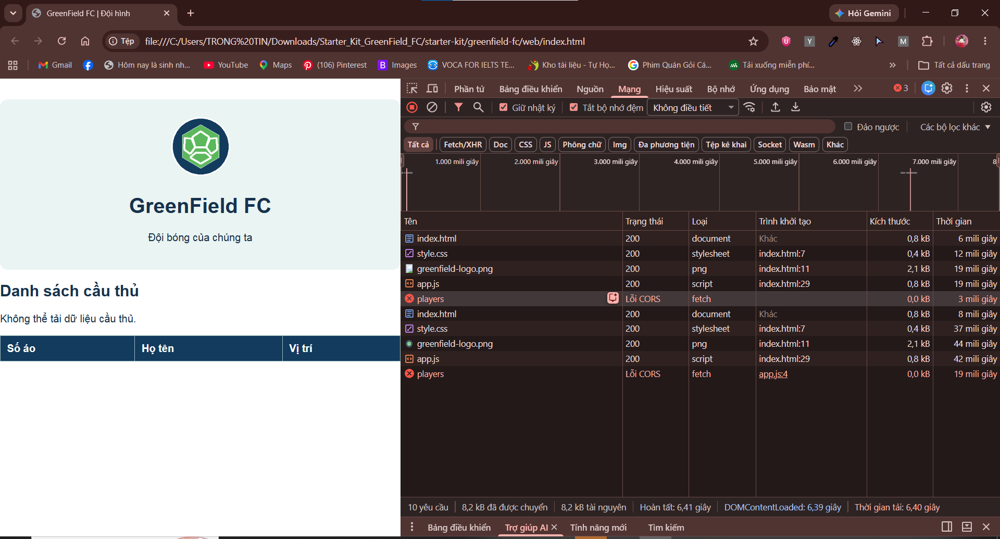

# BÀI LÀM – HACKATHON 02

- **Mã đề:** 01
- **Họ tên:** Phạm Ngọc Linh
- **Lớp:** K26CNTT3
- **Link repository:**
- **Hệ điều hành:** Windows
- **Bài thực hành:** GreenField FC – Quản lý đội bóng

## 4.2. Thao tác máy tính cơ bản bằng CLI

### Các lệnh đã chạy

Các lệnh CLI dùng để thực hiện bài tại thư mục gốc `greenfield-fc`:

```powershell
pwd
ls -Force
mv .\ghi_chu_ban_giao.txt .\docs\
mkdir backup -Force
cp .\data\danh_sach_cau_thu.xlsx .\backup\
Get-ChildItem -LiteralPath . -File -Filter '*.tmp' | Remove-Item
cd logs
ls -Force
cd ..
Get-ChildItem -Recurse -Force
```

### Kết quả liệt kê toàn bộ dự án

Kết quả liệt kê bằng `Get-ChildItem -Recurse -Force` (gồm file ẩn):

```text


    Directory: C:\Users\TRONG TIN\Downloads\Starter_Kit_GreenField_FC\starter-kit\greenfield-fc


Mode                 LastWriteTime         Length Name                                                                                      
----                 -------------         ------ ----                                                                                      
d-----         11/5/2026   1:46 PM                backup                                                                                    
d-----         11/5/2026   1:46 PM                data                                                                                      
d-----         11/5/2026   1:46 PM                docs                                                                                      
d-----         11/5/2026   1:46 PM                evidence                                                                                  
d-----         11/5/2026   1:46 PM                logs                                                                                      
d-----         11/5/2026   1:46 PM                web                                                                                       
-a----         11/5/2026   1:24 PM             92 .env                                                                                      
-a----         11/5/2026   1:46 PM             49 .env.example                                                                              
-a----         11/5/2026   1:46 PM              9 .gitignore                                                                                
-a----         11/5/2026   1:46 PM           6989 bai_lam.md                                                                                
-a----         11/5/2026   1:45 PM           1537 README.md                                                                                 
-a----         11/5/2026   1:45 PM            514 tong_hop.ps1                                                                              


    Directory: C:\Users\TRONG TIN\Downloads\Starter_Kit_GreenField_FC\starter-kit\greenfield-fc\backup


Mode                 LastWriteTime         Length Name                                                                                      
----                 -------------         ------ ----                                                                                      
-a----         11/5/2026   1:24 PM           8624 danh_sach_cau_thu.xlsx                                                                    


    Directory: C:\Users\TRONG TIN\Downloads\Starter_Kit_GreenField_FC\starter-kit\greenfield-fc\data


Mode                 LastWriteTime         Length Name                                                                                      
----                 -------------         ------ ----                                                                                      
-a----         11/5/2026   1:46 PM           9331 danh_sach_cau_thu.xlsx                                                                    


    Directory: C:\Users\TRONG TIN\Downloads\Starter_Kit_GreenField_FC\starter-kit\greenfield-fc\docs


Mode                 LastWriteTime         Length Name                                                                                      
----                 -------------         ------ ----                                                                                      
-a----         11/5/2026   1:24 PM            554 ghi_chu_ban_giao.txt                                                                      


    Directory: C:\Users\TRONG TIN\Downloads\Starter_Kit_GreenField_FC\starter-kit\greenfield-fc\logs


Mode                 LastWriteTime         Length Name                                                                                      
----                 -------------         ------ ----                                                                                      
-a----         11/5/2026   1:24 PM            560 access.log                                                                                
-a----         11/5/2026   1:46 PM            150 loi_500.txt                                                                               
-a----         11/5/2026   1:46 PM            238 tong_hop.txt                                                                              


    Directory: C:\Users\TRONG TIN\Downloads\Starter_Kit_GreenField_FC\starter-kit\greenfield-fc\web


Mode                 LastWriteTime         Length Name                                                                                      
----                 -------------         ------ ----                                                                                      
d-----         11/5/2026   1:46 PM                images                                                                                    
-a----         11/5/2026   1:24 PM            750 app.js                                                                                    
-a----         11/5/2026   1:46 PM            830 index.html                                                                                
-a----         11/5/2026   1:24 PM            401 style.css                                                                                 


    Directory: C:\Users\TRONG TIN\Downloads\Starter_Kit_GreenField_FC\starter-kit\greenfield-fc\web\images


Mode                 LastWriteTime         Length Name                                                                                      
----                 -------------         ------ ----                                                                                      
-a----         11/5/2026   1:24 PM           2115 greenfield-logo.png                                                                       
-a----         11/5/2026   1:24 PM            413 greenfield-logo.svg
```

## 4.3. Lọc log truy cập website

### a) Lệnh lọc các dòng status=500

```powershell
Get-Content .\logs\access.log |
    Select-String '(^|\s)status=500(?=\s|$)' |
    ForEach-Object { $_.Line } |
    Set-Content .\logs\loi_500.txt -Encoding UTF8
Get-Content .\logs\loi_500.txt -TotalCount 2
```

### 2 dòng đầu tiên trong logs/loi_500.txt

```text
2026-10-28 18:03:25 GET /api/players status=500
2026-10-28 18:05:12 GET /api/players status=500
```

### b) Lệnh đếm số dòng status=404 và kết quả

```powershell
(Get-Content .\logs\access.log |
    Select-String '(^|\s)status=404(?=\s|$)' |
    Measure-Object).Count
```

```text
4
```

## 4.4. Chạy script tong_hop.ps1

### Lệnh đã chạy

```powershell
powershell.exe -NoProfile -ExecutionPolicy Bypass -File .\tong_hop.ps1
```

Cách chạy trực tiếp theo đề nếu bị chặn:

```powershell
Set-ExecutionPolicy -Scope Process -ExecutionPolicy Bypass -Force
.\tong_hop.ps1
```

### Nội dung file logs/tong_hop.txt

```text
=== BAO CAO GREENFIELD FC ===
2026-10-28 18:03:22 GET /images/logo-sai.png status=404
2026-10-28 18:07:44 GET /fixtures status=404
2026-10-28 18:13:52 GET /favicon.ico status=404
2026-10-28 18:32:18 GET /api/players status=404
3
```

### Nội dung script

```powershell
# Script: tong_hop.ps1
# Tac gia: Phạm Ngọc Linh
# Ngay tao: 2026-11-05
Write-Output 'Dang tao bao cao...'
'=== BAO CAO GREENFIELD FC ===' | Set-Content .\logs\tong_hop.txt -Encoding UTF8
Get-Content .\logs\access.log |
    Select-String '(^|\s)status=404(?=\s|$)' |
    ForEach-Object { $_.Line } |
    Add-Content .\logs\tong_hop.txt -Encoding UTF8
(Get-Content .\logs\access.log |
    Select-String '(^|\s)status=500(?=\s|$)' |
    Measure-Object).Count |
    Add-Content .\logs\tong_hop.txt -Encoding UTF8
```

## 4.5. README.md và bảo vệ thông tin bí mật

Kết quả thực hiện:

- [x] Tạo README.md có heading, nhấn mạnh, liên kết, logo, danh sách lồng, bảng, code block, task list, blockquote lồng, đường kẻ ngang và escape ký tự.
- [x] Tạo .gitignore có dòng `.env`.
- [x] Tạo .env.example có `CLUB_DB_HOST=`, `CLUB_DB_PASSWORD=`, `API_TOKEN=`, để trống giá trị.
- [x] Kiểm tra tên tệp không có đuôi `.txt` và `.env` được Git bỏ qua.
- [ ] Kiểm tra README bằng Preview trong VS Code.

Không mở nội dung hoặc tải `.env` lên GitHub.

## 4.6. Kiểm tra website và báo cáo lỗi

### Bảng lỗi

| STT | Tab kiểm tra | Lỗi / nguyên nhân | Cách sửa |
| --- | --- | --- | --- |
| 1 | Network | Đường dẫn logo cũ `images/logo-sai.png` không tồn tại. Trong ảnh hiện tại, logo đã tải thành công (200). | Đã đổi thành `images/greenfield-logo.png` trong `web/index.html`. |
| 2 | Network | Yêu cầu `players` tại `app.js:4` báo “Lỗi CORS”; trang mở bằng `file://` và gọi `fetch('/api/players')`. Starter kit không kèm backend cho endpoint này. | Đã bỏ lời gọi API, dùng dữ liệu demo gồm 8 cầu thủ có `ma_doi = GF` từ sheet `CauThu` trong `web/app.js`. |

### Bằng chứng trước khi sửa



Ảnh do người dùng cung cấp cho thấy logo, CSS và JavaScript tải thành công (200), nhưng yêu cầu `players` báo “Lỗi CORS”. Trang hiển thị “Không thể tải dữ liệu cầu thủ.” và bảng trống. Đây là ảnh trước khi sửa.

### Báo cáo lỗi

- **Context:** Google Chrome trên Windows; mở `Starter_Kit_GreenField_FC/starter-kit/greenfield-fc/web/index.html` bằng giao thức `file://`. Chưa thu thập phiên bản Chrome.
- **Expected:** Bảng hiển thị số áo, họ tên, vị trí cầu thủ GreenField FC.
- **Actual trước sửa:** Bảng không có dữ liệu, Network báo “Lỗi CORS” cho yêu cầu `players`, trình khởi tạo `app.js:4`.
- **Nguyên nhân:** Trang chạy từ hệ thống tệp nhưng gọi endpoint API chưa được triển khai. Chỉ chuyển sang localhost vẫn chưa đủ nếu chưa có backend hoặc nguồn dữ liệu thay thế.
- **Khắc phục:** Thay fetch bằng dữ liệu tĩnh từ workbook, tạo ô bằng `textContent`. Đây là dữ liệu demo cố định; thay đổi Excel chưa tự cập nhật lên web.
- **Kiểm tra lại:** Mở `web/index.html`, nhấn `Ctrl+F5`. Kết quả cần thấy: 8 dòng cầu thủ và “Đã tải 8 cầu thủ GreenField FC.”; không còn yêu cầu `players`.
- **Log Console:** Ảnh chỉ chụp tab Network, chưa có thông báo Console nguyên văn. Cần bổ sung ảnh Console và ảnh sau sửa nếu đề yêu cầu; không dùng ảnh này làm bằng chứng sau sửa.

### Câu tìm kiếm Google

```text
Chrome fetch file protocol CORS local file
```


## 4.7. Excel – danh sách cầu thủ

Công thức đã điền vào workbook, sheet `CauThu`:

- J2: `=VLOOKUP(E2;DoiBong!$A$2:$C$3;2;FALSE)`
- I2: `=IFERROR(H2/G2;0)`

Đã thêm J1 là ten_doi vì workbook gốc thiếu cột này. Công thức được điền đến dòng 13, cột I định dạng phần trăm 0.00%.

Đã lưu bộ lọc `ti_le_ghi_ban >= 25%`: **6 cầu thủ** CT005, CT006, CT007, CT008, CT011, CT012.

Nếu Excel không nhận dấu `;`, thay bằng dấu `,` khi nhập công thức.

## 4.8. Excel – thống kê trận đấu

Công thức đã điền vào workbook, sheet `TranDau`:

- F2: `=VLOOKUP(C2;DoiBong!$A$2:$C$3;2;FALSE)`
- G2: `=COUNTIF(CauThu!$E$2:$E$13;C2)`
- H2: `=IF(LEFT(E2;1)="W";3;IF(LEFT(E2;1)="D";1;0))`

Công thức điền đến dòng 7. COUNTIF cho kết quả GF = **8**, AC = **4**.

Đã lưu bộ lọc `diem_thuong >= 3`: **3 trận** TD001, TD004, TD005.

**Giả định:** Đề chưa quy định điểm thưởng; tạm tính thắng 3, hòa 1, thua 0. Cần xác nhận với giảng viên.

Workbook được cập nhật bằng Open XML, có công thức và giá trị cache. Chưa mở kiểm tra trực tiếp bằng Excel. Cần mở workbook đầy đủ, tính lại và lưu trước khi nộp.

## 4.9. GitHub (tùy chọn)

- [ ] Tạo repository riêng cho GreenField FC.
- [ ] Kiểm tra `.env` không có trong danh sách commit, `.env.example` phải có.
- [ ] Tải bài lên và chụp `evidence/github.png`.

## 5. Tự đánh giá

| Kỹ năng | Hoàn thành | Ghi chú |
| --- | --- | --- |
| Tổ chức tệp và CLI | Một phần | Đã sắp xếp thư mục và làm CLI; phần yêu cầu GUI cần tự thực hành. |
| Lọc log và script | Đã thực hiện | 4 dòng 404, 3 dòng 500. |
| Markdown và bảo mật | Một phần | Đã tạo README và các file bảo mật; cần Preview. |
| DevTools và báo cáo lỗi | Một phần | Đã kiểm tra mã; còn ảnh và log Console thật. |
| Excel và thống kê | Một phần | Đã điền công thức và lưu bộ lọc; cần kiểm tra trực quan bằng Excel. |
| GitHub (tùy chọn) | Chưa | Chưa tạo repository. |


